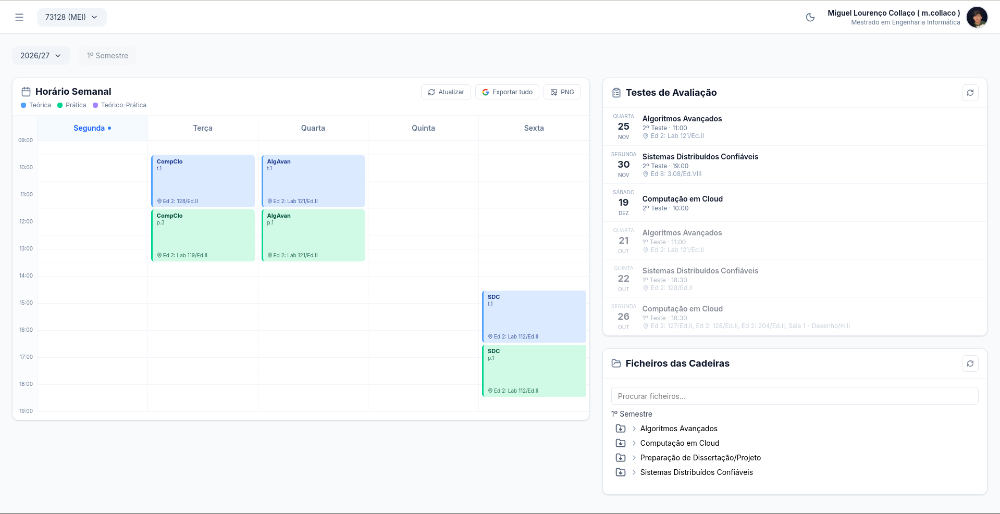

# 🎓 FLIP

**File List and Information Portal** - A modern desktop application for NOVA FCT students to access CLIP quickly and efficiently.

<div align="center">


*Because accessing CLIP shouldn't require 20 clicks and 5 minutes of your time*

</div>

---



---

## ✨ Features

### **Course Materials**
- Browse all your course files by semester/trimester, grouped by CLIP section
- Search files within a course or across all your courses at once
- See each file's date, size and uploader on hover
- Download a single file, or every file from a course as one ZIP (organized into folders by file type)

### **Weekly Schedule**
- Clean, color-coded weekly schedule view
- Export individual classes to Google Calendar
- Export entire schedule with one click
- Automatic recurring (weekly) event creation
- Export the schedule as a PNG image

### **Evaluation Tests**
- See all of the current semester's evaluation tests right on the dashboard
- Date, time, course and rooms for each test at a glance
- Upcoming tests listed first, past ones greyed out at the bottom
- Flags tests you still need to enroll in

### **Cache**
- CLIP pages are cached locally so the app loads instantly
- Each page type has its own expiry: profile and photo 7 days, schedule and tests 1 day
- Course file lists are always fetched fresh, since CLIP's file links expire with the session
- The cache is an encrypted SQLCipher database whose key is kept in your OS keyring

### **Fast & Native**
- Desktop application built with Tauri, with a Rust backend
- Lightning-fast performance
- Cross-platform (Windows, macOS, Linux)
- Minimal memory footprint

### **Secure**
- Direct authentication with CLIP servers
- No data stored externally
- Optional "remember me" saves your login in the OS keyring (Windows Credential Manager, macOS Keychain, Secret Service on Linux)
- Automatically logs back in when the CLIP session expires

### **Light & Dark Theme**
- Switch between light and dark themes with accessible contrast

---

## 🛠️ Tech Stack

Built with modern, performant technologies:

- **Frontend**: Vue 3 + TypeScript + Tailwind CSS 4
- **Desktop**: Tauri 2 (Rust-based)
- **Build Tool**: Vite 8
- **Routing**: Vue Router

---

## Getting Started

### Download (Recommended)

Grab the latest pre-built installer for your OS from the most recent release — no toolchain required:

**[Download the latest release →](https://github.com/miguelflor/FLIP/releases/latest)**

[](https://github.com/miguelflor/FLIP/releases/latest)

### Build from Source

#### Prerequisites

- [Node.js](https://nodejs.org/) (v20.19+ or v22.12+, required by Vite 8)
- [Rust](https://www.rust-lang.org/) (latest stable)
- The Tauri system dependencies for your OS (e.g. WebKitGTK on Linux): see the [Tauri prerequisites](https://tauri.app/start/prerequisites/)

#### Installation

1. **Clone the repository**
   ```bash
   git clone https://github.com/miguelflor/FLIP.git
   cd FLIP
   ```

2. **Install dependencies** (the root and the Vue app each have their own)
   ```bash
   npm install
   cd vue-app && npm install && cd ..
   ```

3. **Run in development mode**
   ```bash
   npm run tauri:dev
   ```

4. **Build for production**
   ```bash
   npm run tauri:build
   ```

   Installers will be created in `src-tauri/target/release/bundle/`

---

## 📁 Project Structure

```
FLIP/
├── vue-app/              # Vue 3 frontend application
│   ├── src/
│   │   ├── components/   # Reusable Vue components
│   │   ├── composables/  # Shared state and logic (student, theme, toasts, queries)
│   │   ├── views/        # Page components (Login, Dashboard, Files, AppLayout)
│   │   ├── lib/          # Utilities and helpers
│   │   └── router/       # Vue Router configuration
│   └── dist/             # Production build output
├── src-tauri/            # Tauri backend (Rust)
│   ├── src/              # Rust source code (CLIP session, scraping, cache)
│   ├── config.json       # Runtime options (e.g. enable logging)
│   ├── tauri.conf.json   # Tauri app configuration
│   └── Cargo.toml        # Rust dependencies
└── package.json          # Root scripts and dependencies
```

---

## Why FLIP?

CLIP is slow and requires too many clicks to access basic information. FLIP solves this by:

- **Instant Access** - No more navigating through endless menus
- **Everything in One Place** - Schedule, upcoming tests and course files on one dashboard
- **One-Click Actions** - Download files or export schedules instantly
- **Native Performance** - Desktop app built with Rust for maximum speed
- **Modern UI** - Clean, intuitive interface with smooth animations
- **Always Available** - Quick access from your desktop

**Time Comparison:**
- **CLIP**: 2-5 minutes to check schedule, 20+ clicks, frequent timeouts
- **FLIP**: 5 seconds, one click, always works ✨


---

## 📝 Available Scripts

```bash
# Development
npm run tauri:dev      # Run Tauri with Vue dev server

# Production
npm run tauri:build          # Build desktop app for your OS
npm run tauri:build:windows  # Cross-compile a Windows build (x86_64-pc-windows-gnu, needs MinGW)

# Vue only (without Tauri)
cd vue-app
npm run dev           # Run Vue dev server (port 1420)
npm run build         # Type-check and build Vue app
npm run lint          # Lint with ESLint (lint:fix to auto-fix)
```

The Vue-only dev server shows the UI, but anything that talks to CLIP needs the Tauri backend.

---

## Contributing

Contributions are welcome! Feel free to:

1. Fork the repository
2. Create a feature branch (`git checkout -b feature/amazing-feature`)
3. Commit your changes (`git commit -m 'Add amazing feature'`)
4. Push to the branch (`git push origin feature/amazing-feature`)
5. Open a Pull Request

---

## ⚠️ Important Notes

- **Not affiliated with NOVA FCT** - This is a student-made improvement project
- **Credentials are secure** - Authentication happens directly with CLIP servers
- **No external storage** - All data comes from CLIP; it is only cached locally (encrypted) on your machine
- **Use responsibly** - Don't overload CLIP servers

---

## 📄 License

Licensed under the [GNU General Public License v3.0](LICENSE).

---

## 🙏 Acknowledgments

- Built with [Tauri](https://tauri.app/), [Vue.js](https://vuejs.org/), and [Tailwind CSS](https://tailwindcss.com/)
- Made with ❤️ by NOVA FCT students

---

<div align="center">

**FLIP - Because your time is valuable** ⚡

*Stop wasting time on CLIP's slow interface. Start using FLIP.*

</div>
